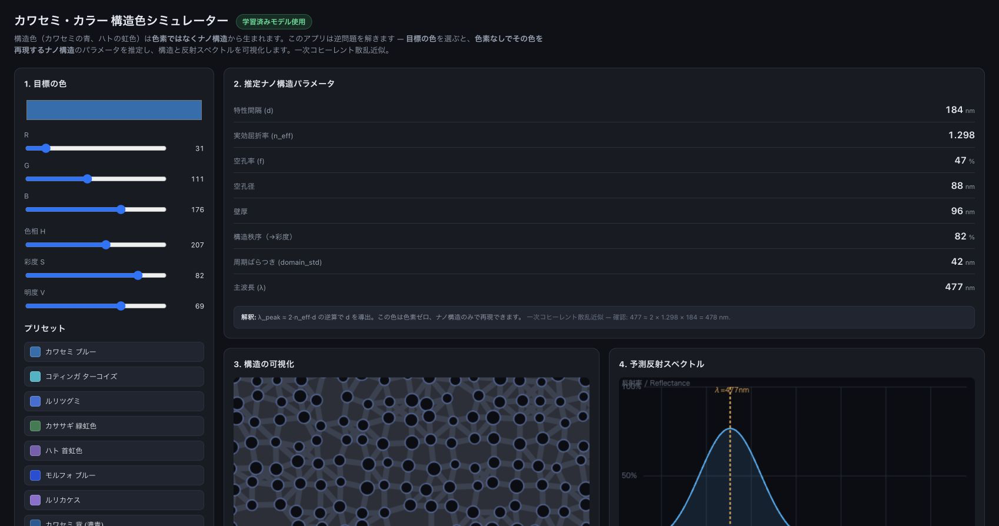
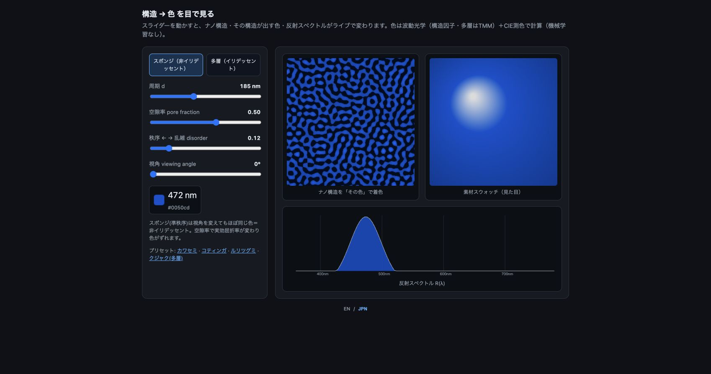
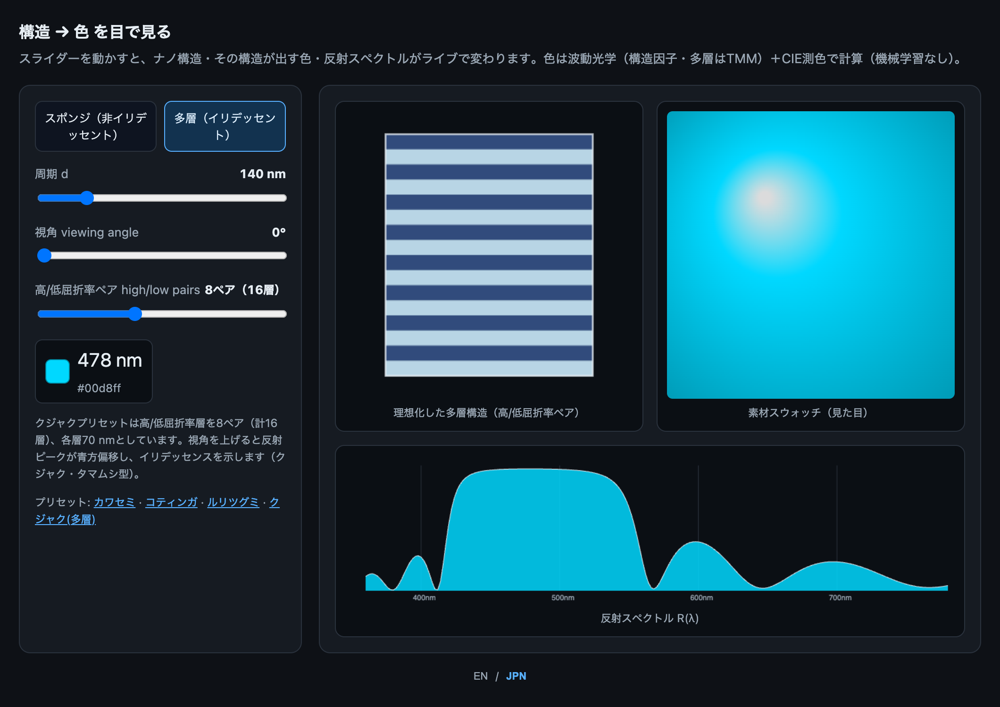
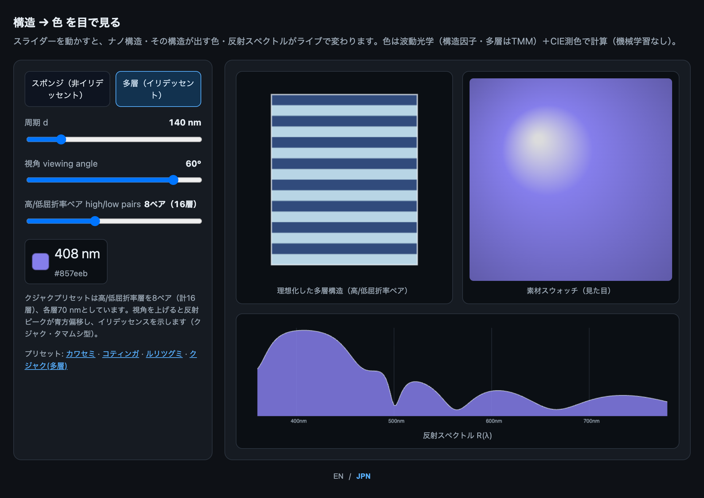

# Kawasemi Colours Webアプリ使い方ガイド

Kawasemi Coloursには、構造色を二つの向きから調べるブラウザーアプリがあります。

- **色から構造を考える** `simulator/index.html`：目標色から、候補となる特性間隔、空孔率、構造秩序などを推定します。
- **構造から色を見る** `simulator/appearance.html`：構造パラメータを動かし、計算される色と反射スペクトルの変化を確認します。

どちらもブラウザー内で動作します。データを外部サービスへ送信しません。

## 起動方法

リポジトリを取得し、そのディレクトリでローカルWebサーバーを起動します。

```bash
git clone https://github.com/suimye/kawasemi-colours.git
cd kawasemi-colours
python3 -m http.server 8000
```

ブラウザーで次のURLを開きます。

- 色から構造：<http://localhost:8000/simulator/index.html>
- 構造から色：<http://localhost:8000/simulator/appearance.html>

画面右下の **EN / JPN** で表示言語を切り替えられます。HTMLファイルを直接開いても基本機能は動きますが、色から構造のアプリで学習済みパラメータを確実に読み込むには、上記のローカルWebサーバーを使用してください。

## 1 色から構造を考える



### 操作

1. **目標の色**を選びます。カラーピッカー、RGB・HSVスライダー、または鳥名のプリセットを使用できます。
2. **推定ナノ構造パラメータ**を確認します。
3. **構造の可視化**で、推定された特性間隔と空孔径を持つケラチン・空気ネットワークを確認します。
4. **予測反射スペクトル**で、ピーク波長とスペクトル幅を確認します。
5. 画面下部の「読み方・原理」を開くと、各パラメータと近似式の意味を確認できます。

### 出力の読み方

| 表示 | 意味 |
|---|---|
| 特性間隔 `d` | ケラチン・空気構造の代表的な相関長です。一般に、小さいほど短波長側、大きいほど長波長側へ移ります。 |
| 実効屈折率 `n_eff` | ケラチンと空気の体積比から求める近似的な屈折率です。 |
| 空孔率 `f` | 構造内で空気が占める割合です。 |
| 空孔径・壁厚 | 可視化に用いる候補構造の幾何学的な目安です。 |
| 構造秩序 | 反射ピークの鋭さと彩度に対応づけた指標です。 |
| `domain_std` | 周期のばらつきです。小さいほど高秩序として扱います。 |
| 主波長 `lambda` | 目標色に対応づけた代表波長です。 |

画面の **目標色** と **構造由来色** は同じ情報ではありません。前者は入力、後者は候補構造から再計算した表示色です。両者の違いも結果の一部として確認してください。

## 2 構造から色を見る

### スポンジ構造



最初は **スポンジ（非イリデッセント）** が選択されています。

1. `d` を動かして、反射ピークが短波長側または長波長側へ移る様子を確認します。
2. **空隙率**を動かして、実効屈折率の変化に伴うピーク移動を確認します。
3. **disorder** を動かして、スペクトル幅と表示色の変化を確認します。
4. 構造像、素材スウォッチ、反射スペクトルを同時に読みます。

スポンジ構造は準秩序ケラチン・空気構造を想定しています。このモードでは、視角を変えても色が大きく変わらない非イリデッセント応答を表します。

### 多層構造と角度依存性

#### 法線入射（0度）



#### 斜入射（60度）



**多層（イリデッセント）**へ切り替えると、理想化した多層薄膜モデルを操作できます。

1. プリセットの**クジャク（多層）**を選びます。
2. **high/low pairs** で高屈折率層と低屈折率層のペア数を設定します。8ペアは計16層です。
3. `d` は二層周期を表します。`d = 140 nm`では、各層の厚さは70 nmです。
4. **viewing angle** を0度から増やします。
5. ピーク波長と表示色が変化することを確認します。

上図は原稿Figure 9と同じ理想化条件（屈折率2.0/1.40、各層70 nm、8ペア＝計16層、入射側1.0、基板側1.5）です。反射ピークは0度の478 nmから60度の408 nmへ70 nm短波長側に移り、表示色もシアンから紫へ変化します。これはtransfer-matrix modelが示す角度依存blue shiftであり、実測スペクトルとの一致を示す図ではありません。

## 3 何に使えるか

- 構造色の特性間隔と反射波長の関係を直感的に確認する
- 候補色から、探索を始めるための構造パラメータを得る
- スポンジ状の非イリデッセント構造と、規則的多層構造の角度依存応答を比較する
- 論文中の構造色モデルと図の読み方を学ぶ

## 4 解釈上の注意

- 色から構造への出力は**候補構造**であり、唯一解や製造仕様ではありません。
- スポンジ構造はコヒーレント単一散乱・構造因子に基づく近似です。
- 多層構造は理想化したtransfer-matrix modelによる比較用モデルです。
- 表示色は計算スペクトルをCIE由来のsRGBへ変換したもので、実物の測色値やモニター間の色一致を保証しません。
- ブラウザーアプリはFDTD/Meepを実行しません。FDTDは別ワークフローの予備的なin-silico cross-checkであり、収束確認、正の対照、独立実測検証は未完です。

このアプリは、構造と色の関係を探索して仮説を作るための研究プロトタイプです。独立した光学測定や製造後の性能確認の代替にはなりません。

## 5 困ったとき

- **学習済みモデル使用と表示されない**：HTMLを直接開かず、`python3 -m http.server 8000`で起動してください。
- **画面が更新されない**：ページを再読み込みし、ブラウザーのJavaScriptが有効か確認してください。
- **日本語に切り替わらない**：画面右下の`JPN`を押してください。選択は同じブラウザー内に保存されます。
- **色が期待と異なる**：目標色と構造由来色を区別し、ピーク波長とスペクトル幅を先に確認してください。

コード、解析データ、ライセンス情報はリポジトリの[README](../README.md)と[日本語README](../README.ja.md)を参照してください。固定版は[Zenodo DOI 10.5281/zenodo.23294442](https://doi.org/10.5281/zenodo.23294442)から取得できます。
